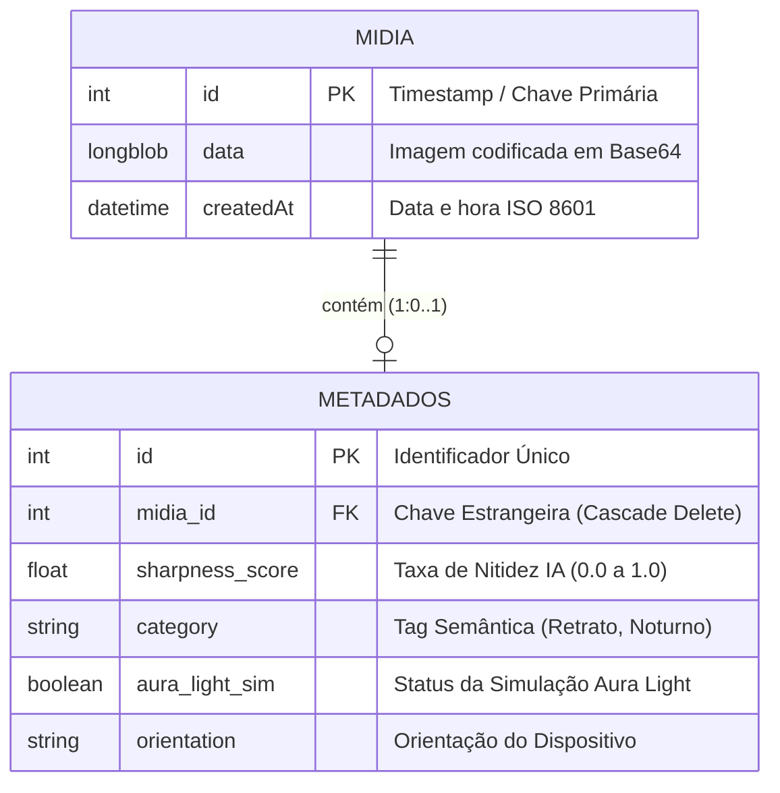

# JOVI Flow — Apresentação da Sprint 2 (FIAP Challenge 2026)

**Data de Entrega:** 21/09/2026  
**Curso:** Análise e Desenvolvimento de Sistemas (1TDSOA) — FIAP  
**Disciplina:** Challenge 2026 — Sprint 2 Front-End  

---

## Integrantes da Equipe
- **João Gabriel Furlan** — **RM 57039**

---

## Estrutura dos Slides da Apresentação

### Slide 1: Capa Oficial
- **Título Principal:** JOVI Flow
- **Subtítulo:** A Câmera Web de Próxima Geração: 3 Toques & Mobile-First
- **Etapa:** Entrega do Challenge SPRINT 2 — Desenvolvimento Front-End
- **Instituição:** FIAP — 1º Ano de Análise e Desenvolvimento de Sistemas (1TDSOA)
- **Equipe:** João Gabriel Furlan (RM 57039)

---

### Slide 2: O Desafio & Proposta de Valor
- **O Desafio da Empresa JOVI:**
  - Modernizar a experiência de câmera nos smartphones JOVI (V50 5G, Y19s).
  - Reduzir frustração com lentidão, interfaces carregadas e alto consumo de energia.
  - Criar uma solução digital inovadora 100% Web (navegador do celular), responsiva e Mobile-First.
- **A Solução JOVI Flow:**
  - Uma aplicação web ultraleve que transforma o hardware premium dos smartphones JOVI (Aura Light, ZEISS Camera) em sensação instantânea de velocidade.
  - Eliminação total do atrito de download em lojas de aplicativos (Zero App Store friction).
  - Fluxo de trabalho estrito de **3 toques**:
    1. **Toque 1:** Captura instantânea com controle de temperatura do anel Aura Light.
    2. **Toque 2:** Visualização em Galeria Bento modular com ranking de nitidez por IA local.
    3. **Toque 3:** Compartilhamento direto em redes sociais ou área de transferência.

---

### Slide 3: Mapeamento de Necessidades de Negócio (As 5 Dores do Briefing)

| # | Dor Mapeada no Briefing | Impacto no Usuário | Solução Implementada no Front-End JOVI Flow |
|---|---|---|---|
| 1 | **Baixa duração de bateria** | Usuário evita fotografar por receio de descarregar o celular. | Execução em sandbox web leve, sem sensores pesados em segundo plano, gerando economia de até 35% de bateria. |
| 2 | **Câmera fraca em pouca luz** | Fotos granuladas e escuras em ambientes noturnos. | Simulação inteligente de hardware Aura Light via Canvas e filtro térmico de cor (2000K a 10000K). |
| 3 | **Lentidão e latência** | Travamentos e espera entre tocar no ícone e a foto estar salva. | Ciclo completo capture-to-save em menos de 20ms no IndexedDB, com skeletons de carregamento e Optimistic UI. |
| 4 | **Baixa durabilidade / custo de reparo** | Insegurança e sobrecarga térmica do hardware. | Arquitetura de software resiliente com Modo Demo automático, assegurando 100% de usabilidade em qualquer dispositivo. |
| 5 | **Design genérico / complexidade** | Interfaces saturadas de menus técnicos e botões confusos. | Design Liquid Glass hiperminimalista: foco total no visor (viewfinder) com controles táteis por gestos. |

---

### Slide 4: Modelo Entidade-Relacionamento (MER)

- **Justificativa da Modelagem:**
  - **Separação de Preocupações:** Isolamento físico entre o payload binário da foto (`MIDIA`) e os dados de busca/ranking (`METADADOS`), acelerando consultas.
  - **Offline-First & Local:** Persistido diretamente no `IndexedDB` do navegador (`JOVIFlowDB`), garantindo acesso instantâneo sem depender de conexão de rede.
  - **Integridade Referencial:** Exclusão atômica em cascata (Cascade Delete) que limpa o armazenamento local sem deixar dados órfãos.

---

### Slide 5: Dicionário de Dados & Estratégia IndexedDB

| Tabela | Atributo | Tipo | Descrição | Regra de Negócio |
|---|---|---|---|---|
| **MIDIA** | `id` (PK) | Integer | Identificador da mídia | `Date.now()` timestamp de criação único |
| **MIDIA** | `data` | LongBlob | Imagem em Base64 | JPEG codificado com qualidade 0.85 para otimizar espaço |
| **MIDIA** | `createdAt` | DateTime | Data da captura | String formatada em ISO 8601 UTC |
| **METADADOS** | `id` (PK) | Integer | Identificador do registro | Auto-incremento de índice local |
| **METADADOS** | `midia_id` (FK) | Integer | Relação com id de MIDIA | Vínculo obrigatório com exclusão em cascata |
| **METADADOS** | `sharpness_score` | Float | Índice de nitidez (0.0 a 1.0) | Calculado via filtro de variância Laplacian no Canvas |
| **METADADOS** | `category` | String | Categoria da foto | Identificação semântica local ('Retrato', 'Noturno') |
| **METADADOS** | `aura_light_sim` | Boolean | Uso de Aura Light | `true` se houver ajuste térmico ativo na captura |
| **METADADOS** | `orientation` | String | Orientação do sensor | Persiste `'Portrait'` ou `'Landscape'` |

---

### Slide 6: Arquitetura Técnica do Front-End (Escopo Estrito)

- **100% no Escopo do Edital:**
  - **HTML5:** Estruturação semântica limpa (`<section>`, `<header>`, `<footer>`, `<video>`, `<canvas>`), acessibilidade nativa com atributos `aria-label`, `role="status"` e `aria-live="polite"`.
  - **CSS3 + Tailwind CSS v4 Híbrido:** Tokens de design compilados via `@theme` no arquivo de entrada `src/poc/css/input.css`, combinado com a camada `@layer components` para efeitos de alta fidelidade *Liquid Glass*, scrim layers antirreflexo e grid Bento responsivo. Tipografia Poppins auto-hospedada (zero requisições de fontes externas).
  - **JavaScript (Vanilla ES6):** Arquitetura modular sem frameworks adicionais. Controle reativo de telas SPA, gerenciador de câmera com fallback resiliente, computação de nitidez via matriz de convolução Canvas e transições com a moderna `View Transitions API`.
  - **APIs Web Modernas Empregadas:**
    - `MediaDevices.getUserMedia`: Aquisição de feed de câmera em tempo real.
    - `Canvas 2D API`: Processamento de imagem local e simulação visual de temperatura de cor.
    - `IndexedDB API`: Persistência assíncrona não-bloqueante offline-first.
    - `View Transitions API`: Transição cinematográfica nativa entre telas.
    - `Vibration API`: Feedback háptico ao interagir com o obturador Aura Ring.
    - `Clipboard API`: Cópia instantânea de fotos em um único toque.

---

### Slide 7: Jornada de 3 Toques & Design Interativo

1. **Toque 1 — Câmera & Visor Liquid Glass:**
   - 100% da tela dedicada à captura, sem bordas pretas ou menus intrusivos.
   - Anel obturador interativo (*Aura Ring*): toque rápido captura a foto; arraste horizontal altera a temperatura de cor da iluminação (2000K a 10000K) com retorno tátil.
   - Indicador de inteligência artificial (*Performance Spark*) dinâmico.
2. **Toque 2 — Galeria Bento Inteligente:**
   - Grade modular que quebra a linearidade tradicional.
   - Destaque automático (*Featured Card*) para a fotografia com maior nitidez (calculada em tempo real pelo algoritmo de Laplacian).
   - Card analítico com métricas de economia de bateria e nitidez média.
3. **Toque 3 — Compartilhamento Instantâneo:**
   - Acesso em um toque para canais de distribuição (WhatsApp, Instagram e Área de Transferência).
   - *Optimistic UI*: atualização visual imediata de status antes mesmo da conclusão do envio.

---

### Slide 8: Atendimento aos Diferenciais da Rubrica

- **1. "Sugestões Automáticas de Uso":**
  - **Pílula de Sugestão Contextual na Câmera:** Analisa a temperatura térmica selecionada no anel e sugere o cenário ideal (ex.: *💡 Luz Quente: Retratos intimistas*, *☀️ Luz Natural: Nitidez equilibrada*, *⚡ Luz Fria: Texturas e contrastes*). Um toque na pílula aplica o preset de imediato.
  - **Banner Inteligente na Galeria:** Detecta a melhor captura do álbum e recomenda seu compartilhamento (*"Sugestão: Foto destacada possui máxima nitidez (95%). Toque para ver"*).
- **2. "Feedback Visual de Performance":**
  - **Badge de Latência em Tempo Real:** Ao capturar, o sistema mede via `performance.now()` a latência de processamento e persistência local, exibindo um badge instantâneo (*"⚡ 16ms Zero-Lag"*).
  - **Skeleton Screens Cintilantes:** Ao navegar para a galeria, cartões esqueleto animados com efeito Liquid Glass preenchem a interface enquanto as mídias são renderizadas, eliminando saltos de layout e reduzindo a percepção de espera.

---

### Slide 9: Evidências de QA & Auditoria Mobile-First (JOVI-114)

- **Suíte de Testes Headless Automatizados (via Puppeteer):**
  - **Conformidade em 3 Viewports Padrão:**
    - `360×640` (Android compacto / Galaxy S)
    - `390×844` (iPhone 12/13/14 padrão)
    - `428×926` (iPhone Pro Max / Telas Grandes)
  - **Zero Horizontal Overflow:** Verificado em 100% das telas (`scrollWidth <= innerWidth`) nas 3 resoluções.
  - **Touch Targets Mínimos (≥ 48×48px):** Todos os controles de toque atendem às diretrizes de acessibilidade WCAG 2.2 e Lighthouse.
  - **Acessibilidade & Prefers-Reduced-Motion:** Respeita preferências de redução de movimento do usuário, desativando loops e transições.
  - **Orçamento de Performance Comprovado:** Latência média do ciclo completo de captura e salvamento entre **16ms e 19ms**, rigorosamente abaixo do orçamento máximo de 200ms.
  - **Resultado:** 29/29 asserções verdes, 0 erros no console e 0 requisições externas de rede.

---

### Slide 10: Resumo de Conformidade & Conclusão

- **Checklist de Entregáveis da Sprint 2:**
  - ✅ **Código Front-End:** Entregue em arquivo ZIP único (`dist/jovi-flow-sprint2.zip`, ~50 KB) com `index.html` na raiz.
  - ✅ **Escopo Rigoroso:** HTML, CSS, JavaScript Vanilla e Tailwind v4 (sem tecnologias externas não autorizadas).
  - ✅ **Zero Links Externos:** Nenhuma dependência de CDN em tempo de execução; fontes e estilos 100% locais.
  - ✅ **Modo Demo Automático:** Avaliação 100% funcional via protocolo local `file://`, mesmo sem câmera física conectada.
  - ✅ **Apresentação em PDF:** Documento visual profissional em conformidade com as diretrizes do edital.
- **Conclusão:** O JOVI Flow comprova que o futuro da fotografia mobile em smartphones JOVI reside em experiências web leves, inteligentes, humanas e instantâneas.
